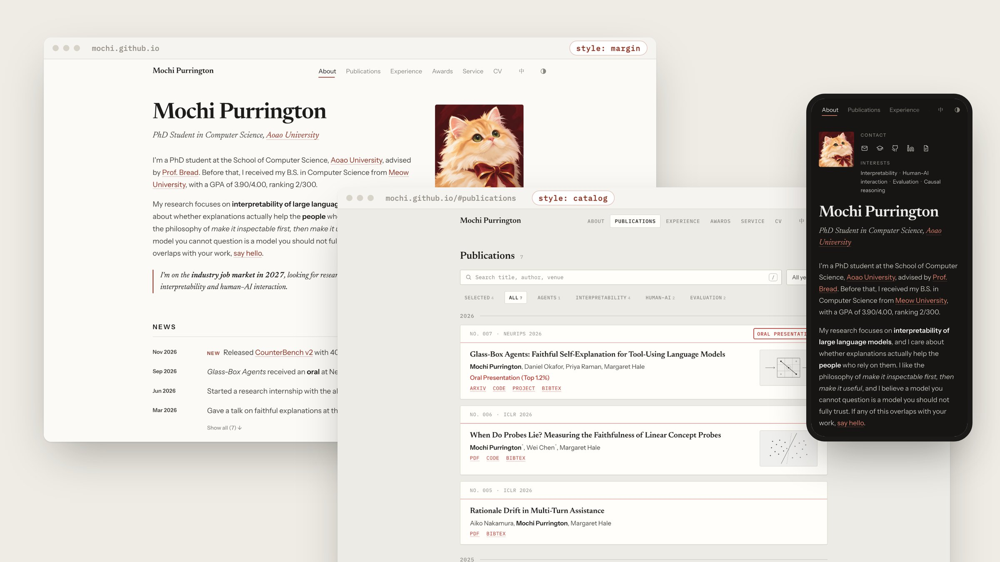
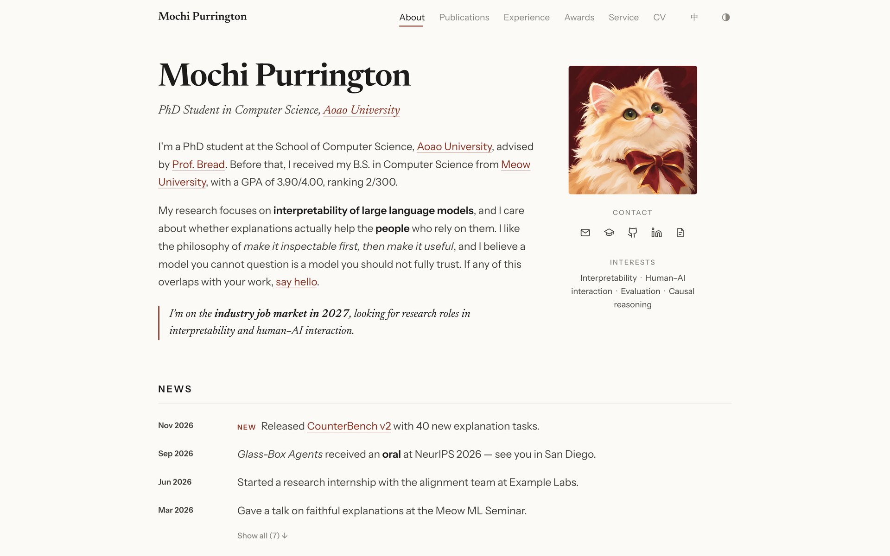
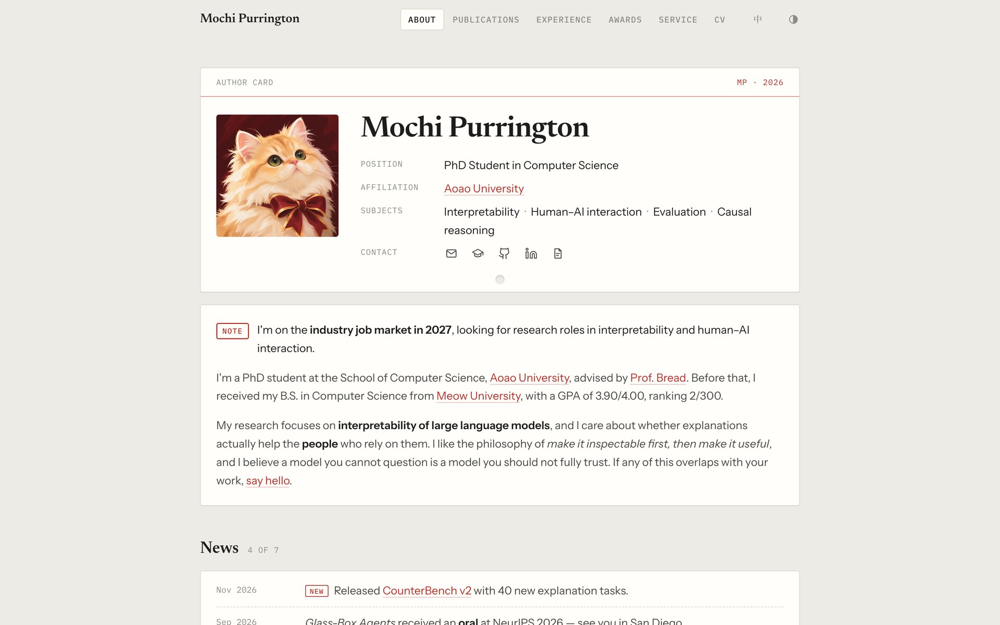
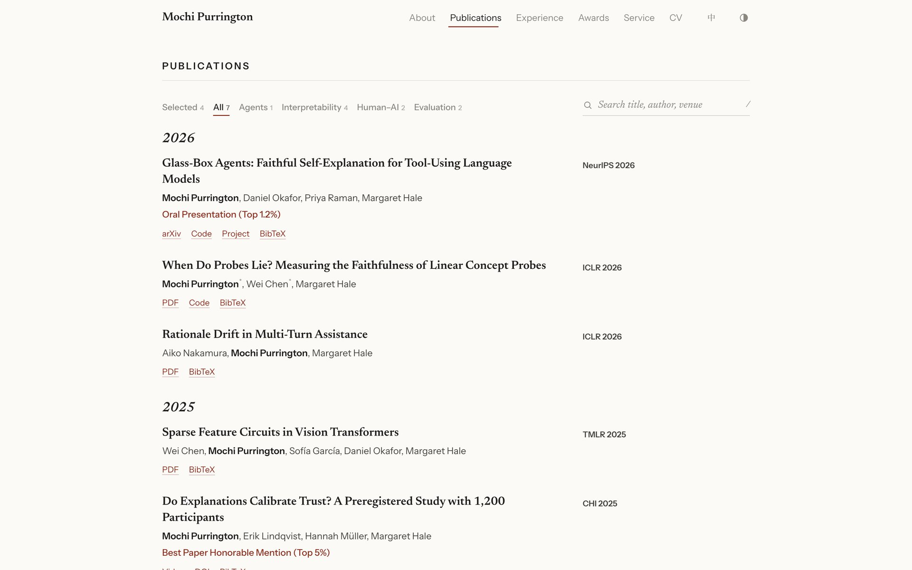
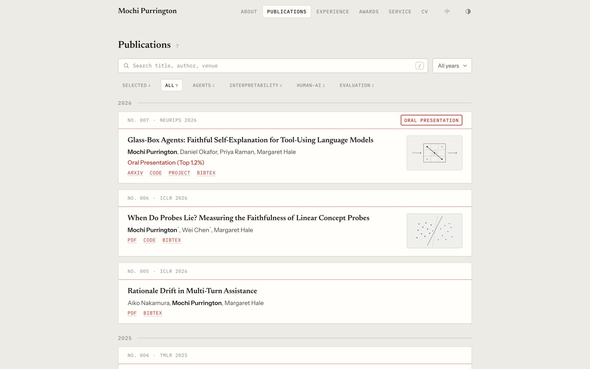
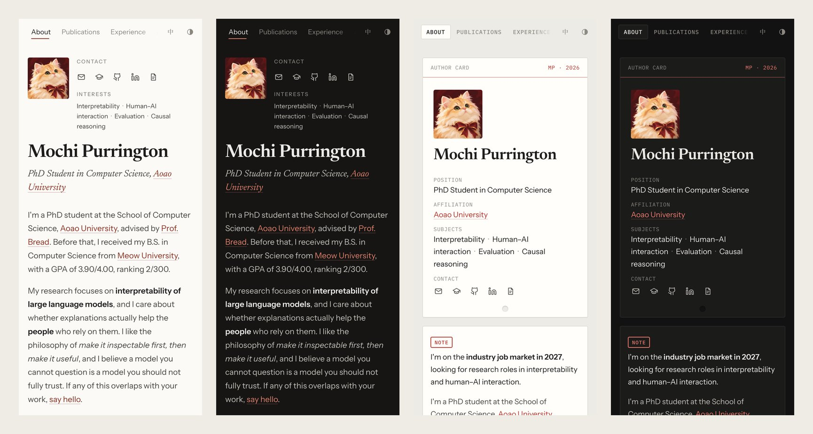

<div align="center">

# Colophon

**An academic homepage set like a paper.**<br>
One YAML file, one BibTeX file, zero build. Free on GitHub Pages.

[**Live demo**](https://YOUR-GITHUB-NAME.github.io/colophon/) · [**Try both looks**](https://YOUR-GITHUB-NAME.github.io/colophon/preview/) · [**Use this template**](../../generate) · [中文说明](README.zh-CN.md)

<br>



</div>

<br>

Colophon turns a `config.yml` and the `publications.bib` you already keep into a quiet, complete academic homepage. There's no Jekyll, no Node and no build step. Edit two text files on GitHub and the site updates itself.

## Two looks

Both looks read the same files, so you switch with one line: `style: margin` or `style: catalog`.

<table>
<tr>
<td width="50%" valign="top">

<p><b>Margin</b> · <code>style: margin</code> (default)</p>
<p>Set like a paper. One text column, with dates, venues, your photo, contact icons and interests in the margin, the way a paper keeps its side notes. Newsreader headings, Instrument Sans text, one oxblood ink.</p>
</td>
<td width="50%" valign="top">

<p><b>Catalog</b> · <code>style: catalog</code></p>
<p>A library card catalogue. An author card with typed fields, every paper on its own numbered index card, awards as red stamps, news as a dated log.</p>
</td>
</tr>
<tr>
<td></td>
<td></td>
</tr>
</table>



## What you get

- **Publications straight from BibTeX.** Paste from Google Scholar, DBLP or Zotero. LaTeX accents (`M{\"u}ller`), `@string` macros, `$\epsilon$`, equal-contribution marks and `Last, Jr., First` names all render properly, and your own name is set in bold.
- **Search and filter.** Press `/` to search titles, authors and venues as you type, with the hits highlighted. Filter by topic once you add `topic = {Agents, Evaluation}` to entries.
- **Award lines.** `award = {Oral Presentation (Top 1.2%)}` gets its own line under the authors. No long venue names: the short `abbr` is enough.
- **Pages, not one long scroll.** Each top-bar item opens its own page with its own address (`#publications`), so Back, bookmarks and shared links work. Prefer one scrolling page? Set `tabs: false`.
- **Two languages, one switch.** Add a `config.zh.yml` with only the fields you want in Chinese, and a 中 / EN button appears. Each language shows its own name for you.
- **Contact icons.** Email, Scholar, GitHub, LinkedIn, CV and more, with icons picked from the link. Email opens a small card showing `name (at) domain` and a *Send email* button, and the address never sits in the HTML for scrapers to find.
- **Quiet motion.** A highlight slides between top-bar items, the bar turns to frosted glass once you scroll, and content rises in when you switch pages. It honours *reduce motion*, and nothing waits on an animation to become visible.
- **Dark mode, phones, print.** Both looks follow the system theme, fit a phone, and print as a clean one-pager.
- **Friendly errors.** A typo in YAML or BibTeX shows the file, the line and a hint instead of a blank page.
- **Small.** About 100 KB of plain JavaScript and CSS plus a vendored YAML parser. Search engines get a filled-in `<title>`, description and a schema.org `Person` record.

## Set up in three steps

1. **Click [Use this template](../../generate)** and name the new repository **`<your-github-name>.github.io`**.
2. **Edit `config.yml` and `publications.bib`** right on GitHub (open the file → pencil icon → *Commit changes*). Put your photo and paper teasers in `assets/`.
3. **Turn on Pages:** *Settings → Pages → Build and deployment → Source: Deploy from a branch → `main` / `(root)` → Save.*

A minute later your site is live at `https://<your-github-name>.github.io`, and every later commit updates it.

> Any repository name works. The site then lives at `https://<your-github-name>.github.io/<repo>/`.
> The `preview/` folder is only the showcase page for this project. You can delete it from your own site.

## Editing

### `config.yml`

Everything is optional except `name`. The shipped file is fully commented. These are the main keys:

```yaml
name: Mochi Purrington
name_alt: 糯米喵                 # shown instead of `name` on the Chinese page
role: PhD Student in Computer Science
affiliation: "[Aoao University](https://example.edu)"
avatar: assets/avatar.webp
email: mochi@example.edu
links:
  - { label: Scholar, url: "https://scholar.google.com/" }
  - { label: GitHub,  url: "https://github.com/" }
callout: I'm on the **industry job market in 2027**.

theme:
  style: margin                   # margin · catalog
```

| Key | What it does |
| --- | --- |
| `name`, `name_alt` | Your name, and optionally your name in the other language. Only one is shown: the Chinese one on Chinese pages, the other one otherwise. |
| `role`, `affiliation` | The lines under your name. Markdown links work. |
| `advisor`, `location`, `pronouns` | Filled in but hidden by default. Turn them on with `show: { advisor: true, location: true, pronouns: true }`. `advisor` takes one or a list of `{name, url}`. |
| `avatar` | Path to a photo, e.g. `assets/avatar.jpg`. Leave it empty for a monogram. |
| `email` | Rendered by script, so naive scrapers never see it in the HTML. |
| `links` | A list of `{label, url}` shown as icon buttons. Icons are picked from the label or URL, or set `icon:`. A link labelled `CV` also appears in the top bar. |
| `about`, `interests` | Markdown bio under your name, and your research interests. |
| `callout` | One highlighted sentence for what matters right now. Markdown works. |
| `news` | `{show, items: [{date, text}]}`. Older items fold under *Show all*. |
| `sections` | Extra pages (Experience, Awards, Teaching, Service…), each with `items: [{date, title, detail, url}]` or free `markdown`. |
| `order`, `menu`, `short_name` | Order of the pages, top-bar items, and the name shown in the top bar. |
| `me` | Spellings of your name to set in bold in author lists. |
| `publications` | `{file, default: selected \| all, previews: true}`, or `false` to hide the page. |
| `call_number` | Catalog look only: the red “call number” on your author card (default: your initials and the year). |
| `footer`, `updated`, `credit` | Footer text, the “Updated …” date (automatic), and the small *Built with Colophon* line. |
| `lang`, `labels` | `en` or `zh` for headings and small labels. Override any label under `labels:`. |
| `config.zh.yml` | Optional translation with only the fields that differ (lists such as `news` and `sections` are replaced whole). Adds the 中 / EN switch. Use `config.en.yml` if your main config is Chinese. |

**Theme options** (`theme:`):

| Key | Values |
| --- | --- |
| `style` | `margin` · `catalog` |
| `accent` | Optional link colour, e.g. `"#2f5db3"`. Dark mode lightens it automatically. |
| `tabs` | `true`: each top-bar item is its own page · `false`: one scrolling page |
| `nav` | `true` · `false` (no top bar, which also means one scrolling page) |
| `paper` | `plain` · `grid` · `dots` |
| `mode` | `auto` · `light` · `dark`. Visitors can still toggle. |
| `fonts` | `web` (Google Fonts) · `system` (no external requests at all) |
| `font_cdn` | A Google Fonts mirror, e.g. `https://fonts.loli.net` for visitors in mainland China |

**Try options on your own content:** open `https://<you>.github.io/?customize`. A small panel lets you switch looks, accent, paper and mode live, then copies a ready-made `theme:` block for `config.yml`. It only previews: visitors see nothing until you commit. URL parameters work too: `?style=catalog`, `?mode=dark`, `?lang=zh`, `?accent=2f5db3`, `?paper=grid`, `?tabs=off`.

### `publications.bib`

Plain BibTeX. Add any of these optional fields to decorate an entry:

```bibtex
@inproceedings{purrington2026glassbox,
  title     = {Glass-Box Agents: Faithful Self-Explanation for Tool-Using LMs},
  author    = {Purrington, Mochi* and Okafor, Daniel* and Hale, Margaret†},
  booktitle = {Advances in Neural Information Processing Systems},
  year      = {2026},
  selected  = {true},                         % show under “Selected” on the home page
  abbr      = {NeurIPS},                      % short venue label
  topic     = {Agents, Interpretability},     % filter buttons above the list
  award     = {Oral Presentation (Top 1.2%)}, % its own line under the authors
  preview   = {assets/papers/glassbox.png},   % teaser image, 16:10 works best
  arxiv     = {2605.01234},                   % id or full URL
  pdf       = {https://…},  code = {https://…},  project = {https://…},
  video     = {https://…},  slides = {https://…}, poster = {https://…}, blog = {https://…},
  equal     = {2},                            % alternative to *: first N authors are equal
}
```

`*` marks equal contribution and `†` a corresponding author, and a legend appears automatically. Entries are sorted by `year` and `month`, so their order in the file doesn't matter. `doi`, `url` and `eprint`/`archivePrefix` are picked up too. *Copy BibTeX* strips these decoration fields, so visitors get a clean citation.

## Link previews

When you paste a link into WeChat, X, Slack or iMessage, they show a small card with a title, a summary and an image. That card comes from `og:` tags in the page's HTML. Those apps don't run JavaScript, so they can't see what Colophon fills in at runtime. If you want a proper card, open `index.html`, fill in the four commented lines near the top (name, one-line summary, full URL of a photo), and remove the comment marks. Google runs JavaScript, so search results look right either way.

## Preview locally

Colophon reads its files over HTTP, so open it through any static server rather than double-clicking `index.html`:

```bash
python3 -m http.server 8000
```

Then visit <http://localhost:8000>. The showcase page is at <http://localhost:8000/preview/>.

## Custom domain and other hosts

Add your domain under *Settings → Pages → Custom domain* and point a `CNAME` DNS record at `<you>.github.io`. Any static host works as well: Netlify, Cloudflare Pages, Vercel, or your department's web space. Just upload the folder.

## FAQ

**Is this a static site?** Yes. The server only hands out files; there's no backend and no database. The page is put together in the visitor's browser, which is why editing a text file is all it takes to update it.

**Will Google index it?** Yes. Google renders JavaScript, and Colophon fills in `<title>`, the meta description and a schema.org `Person` record.

**Why not Jekyll, Hugo or al-folio?** They are powerful, but every update means a toolchain. Colophon is for people who would rather write papers: two text files, nothing to install, nothing to break.

**My visitors are in mainland China.** Set `theme.fonts: system` or a `font_cdn` mirror. Everything else is served from your own site.

## Project layout

```
config.yml              ← you edit this
config.zh.yml           ← optional Chinese version
publications.bib        ← and this
assets/                 ← your photo, CV, paper teasers
index.html              ← page shell, no need to touch
colophon/colophon.js    ← renderer, BibTeX + Markdown parsing
colophon/colophon.css   ← the two looks
colophon/vendor/        ← js-yaml 4.1.0 (MIT)
preview/                ← showcase page and screenshots (safe to delete)
```

## Credits

Typefaces: [Newsreader](https://fonts.google.com/specimen/Newsreader), [Instrument Sans](https://fonts.google.com/specimen/Instrument+Sans), [IBM Plex Mono](https://fonts.google.com/specimen/IBM+Plex+Mono) and [Noto Serif SC](https://fonts.google.com/noto/specimen/Noto+Serif+SC), all under the SIL Open Font License. YAML parsing by [js-yaml](https://github.com/nodeca/js-yaml) (MIT).

## License

MIT. The sample person, papers and institutions are fictional.
