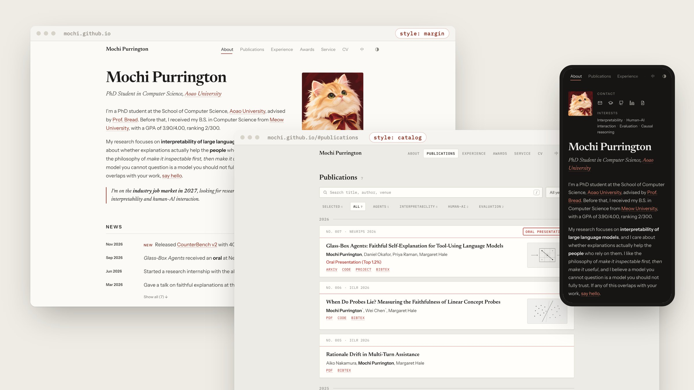
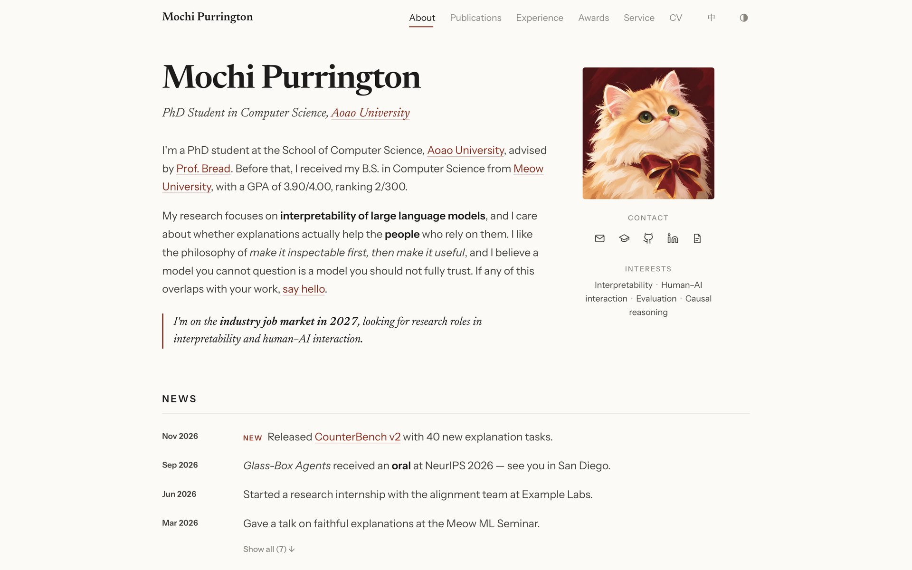
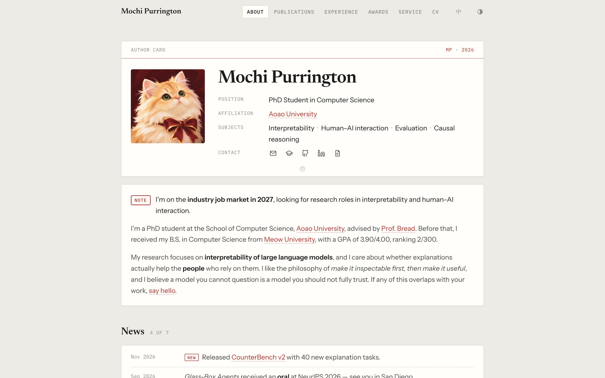
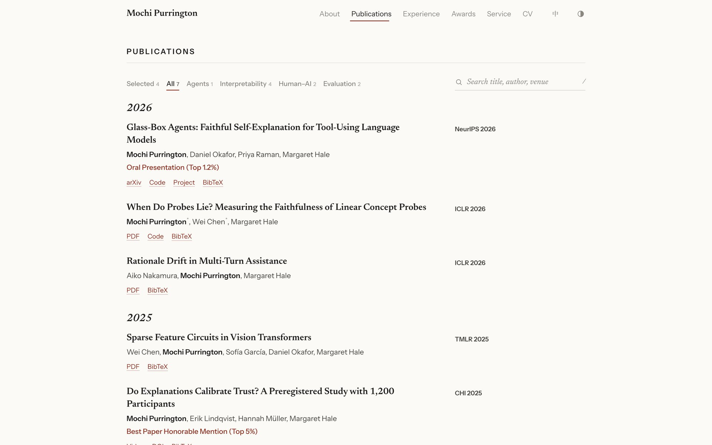
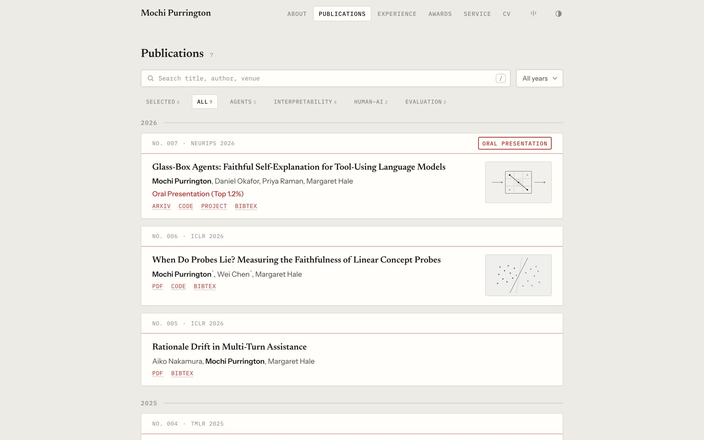
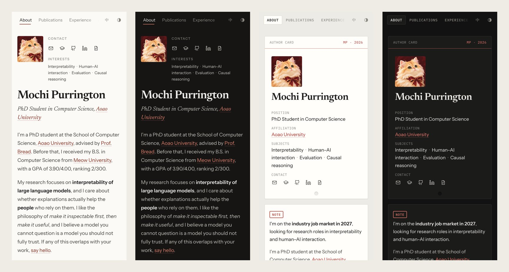

<div align="center">

# Colophon

**像论文一样排版的学术主页。**<br>
一个 YAML，一个 BibTeX，零构建，免费托管在 GitHub Pages。

[**在线演示**](https://YOUR-GITHUB-NAME.github.io/colophon/?lang=zh) · [**对比两种外观**](https://YOUR-GITHUB-NAME.github.io/colophon/preview/) · [**使用这个模板**](../../generate) · [English](README.md)

<br>



</div>

<br>

Colophon 把一个 `config.yml` 和你手里现成的 `publications.bib` 变成一个安静、完整的学术主页。不需要 Jekyll，不需要 Node，也没有构建步骤：在 GitHub 网页上改两个文本文件，网站就会自动更新。

## 两种外观

两种外观读的是同一份文件，切换只需改一行：`style: margin` 或 `style: catalog`。

<table>
<tr>
<td width="50%" valign="top">

<p><b>Margin</b> · <code>style: margin</code>（默认）</p>
<p>像一篇论文。正文一栏，日期、会议、照片、联系图标和研究兴趣都写在页边，像论文的旁注。标题用 Newsreader，正文用 Instrument Sans，只用一种深红墨色。</p>
</td>
<td width="50%" valign="top">

<p><b>Catalog</b> · <code>style: catalog</code></p>
<p>图书馆目录卡。一张写着字段的“作者卡”，每篇论文是一张编号卡片，获奖像红色印章，动态排成按日期记录的日志。</p>
</td>
</tr>
<tr>
<td></td>
<td></td>
</tr>
</table>



## 功能

- **论文直接读 BibTeX**：从 Google Scholar、DBLP、Zotero 复制即可。LaTeX 重音（`M{\"u}ller`）、`@string` 宏、`$\epsilon$`、共同一作标记、`Last, Jr., First` 格式都能正确显示，你的名字自动加粗。
- **搜索和筛选**：按 `/` 直接搜索标题、作者和会议，边输入边高亮匹配文字；给条目加上 `topic = {Agents, Evaluation}` 就能按研究方向筛选。
- **获奖说明单独一行**：`award = {Oral Presentation (Top 1.2%)}` 会显示在作者下面。不显示冗长的会议全称，简称 `abbr` 就够了。
- **按页切换，而不是一长条滚动**：导航栏每一项是独立页面，有自己的网址（如 `#publications`），后退、收藏、分享链接都能用。想要一页滚到底，设 `tabs: false`。
- **一键中英切换**：新建 `config.zh.yml`，只写需要翻译的字段，导航栏就会出现“中 / EN”按钮。中文页面显示中文名，英文页面显示英文名。
- **联系方式图标**：邮箱、Scholar、GitHub、领英、CV 等，图标根据链接自动匹配。点邮箱会弹出一张小卡片，显示 `name (at) domain` 和“发送邮件”按钮；邮箱地址不会直接写在 HTML 里被爬虫抓走。
- **克制的动效**：导航栏高亮块滑动，滚动后导航栏变成毛玻璃，切换页面时内容依次浮现。尊重系统的“减少动态效果”设置，内容从不依赖动画才显示。
- **深色模式、手机、打印**：两种外观都跟随系统深浅色，适配手机，打印出来是干净的一页。
- **友好的报错**：YAML 或 BibTeX 写错时，页面会指出哪个文件、第几行、怎么改，而不是一片空白。
- **小**：约 100 KB 的原生 JavaScript 和 CSS，外加一个 YAML 解析器。会为搜索引擎生成标题、简介和 schema.org 结构化数据。

## 三步上线

1. 点击 **[Use this template](../../generate)**，仓库名填 **`<你的GitHub用户名>.github.io`**。
2. 在 GitHub 网页上直接**编辑 `config.yml` 和 `publications.bib`**（打开文件 → 铅笔图标 → *Commit changes*）。照片和论文配图放进 `assets/`。
3. **打开 Pages**：*Settings → Pages → Build and deployment → Source 选 Deploy from a branch → `main` / `(root)` → Save*。

大约一分钟后，主页就会出现在 `https://<你的GitHub用户名>.github.io`，之后每次提交都会自动更新。

> 仓库也可以叫别的名字，这时网址是 `https://<你的GitHub用户名>.github.io/<仓库名>/`。
> `preview/` 文件夹只是这个项目的展示页，你自己的主页里可以删掉。

## 编辑说明

### `config.yml`

除了 `name` 都是可选的，文件里每一项都有注释。常用的字段：

```yaml
name: Mochi Purrington
name_alt: 糯米喵                 # 中文页面显示这个名字
role: PhD Student in Computer Science
affiliation: "[Aoao University](https://example.edu)"
avatar: assets/avatar.webp
email: mochi@example.edu
links:
  - { label: Scholar, url: "https://scholar.google.com/" }
  - { label: GitHub,  url: "https://github.com/" }
callout: I'm on the **industry job market in 2027**.

theme:
  style: margin                   # margin · catalog
```

| 字段 | 作用 |
| --- | --- |
| `name` / `name_alt` | 英文名 / 中文名。只显示一个：中文页面显示中文名，英文页面显示英文名 |
| `role` / `affiliation` | 名字下面的身份和单位，支持 Markdown 链接 |
| `advisor` / `location` / `pronouns` | 导师、所在地、称呼，默认不显示；需要时设 `show: { advisor: true, location: true, pronouns: true }` |
| `avatar` | 照片路径，如 `assets/avatar.jpg`；留空则显示姓名缩写头像 |
| `email` | 由脚本生成，简单的爬虫在 HTML 里看不到 |
| `links` | 联系方式图标按钮，图标根据名称或网址自动匹配，也可以写 `icon:`；名为 `CV` 的链接也会出现在顶部导航栏 |
| `about` / `interests` | 名字下面的简介（Markdown）和研究兴趣 |
| `callout` | 一句醒目提示，比如“正在找博后 / 工作”，支持 Markdown |
| `news` | 动态，超过 `show` 条后自动折叠 |
| `sections` | 自定义页面（经历、获奖、教学、学术服务……） |
| `order` / `menu` / `short_name` | 页面顺序、导航栏条目、导航栏上显示的名字 |
| `me` | 在作者列表里需要加粗的你的名字写法 |
| `call_number` | 仅 catalog 外观：作者卡右上角的红色“检索号”（默认是姓名缩写加年份） |
| `footer` / `updated` / `credit` | 页脚文字、“更新于”日期（自动）、*Built with Colophon* 署名 |
| `lang` | `zh` 时栏目标题显示为“简介 / 动态 / 论文 / 代表作”等 |
| `config.zh.yml` | 可选的中文版，只写和 `config.yml` 不同的字段（`news`、`sections` 这类列表要写全）。有了它，导航栏出现“中 / EN”切换 |

**外观设置**（`theme:`）：

| 字段 | 取值 |
| --- | --- |
| `style` | `margin` · `catalog` |
| `accent` | 可选的链接颜色，如 `"#2f5db3"`；深色模式自动调亮 |
| `tabs` | `true` 导航栏切换页面 · `false` 一整页滚动 |
| `nav` | `true` · `false`（不要导航栏，此时只能一整页滚动） |
| `paper` | `plain` 纯色 · `grid` 方格纸 · `dots` 点阵纸 |
| `mode` | `auto` · `light` · `dark`，访客仍可手动切换 |
| `fonts` | `web`（Google Fonts）· `system`（完全不请求外部资源） |
| `font_cdn` | Google Fonts 镜像，国内访问可设为 `https://fonts.loli.net` |

**在自己的内容上试外观**：打开 `https://<你的用户名>.github.io/?customize`，右下角面板可以实时切换外观、链接颜色、背景纸和深浅模式；选好后点 *Copy theme*，粘贴到 `config.yml` 的 `theme:` 位置。面板只是预览，提交之前访客看不到任何变化。也可以直接用网址参数：`?style=catalog`、`?mode=dark`、`?lang=zh`、`?accent=2f5db3`、`?paper=grid`、`?tabs=off`。

### `publications.bib`

普通 BibTeX，可以加这些可选字段：

```bibtex
@inproceedings{purrington2026glassbox,
  title     = {Glass-Box Agents: Faithful Self-Explanation for Tool-Using LMs},
  author    = {Purrington, Mochi* and Okafor, Daniel* and Hale, Margaret†},
  booktitle = {Advances in Neural Information Processing Systems},
  year      = {2026},
  selected  = {true},                         % 列为首页“代表作”
  abbr      = {NeurIPS},                      % 会议简称
  topic     = {Agents, Interpretability},     % 研究方向，用于筛选
  award     = {Oral Presentation (Top 1.2%)}, % 作者下面单独一行
  preview   = {assets/papers/glassbox.png},   % 配图，16:10 最佳
  arxiv     = {2605.01234},                   % 编号或完整网址
  pdf       = {https://…},  code = {https://…},  project = {https://…},
  video     = {https://…},  slides = {https://…}, poster = {https://…}, blog = {https://…},
  equal     = {2},                            % 前两位作者共同一作（也可以在名字后写 *）
}
```

`*` 表示共同一作，`†` 表示通讯作者，页面会自动加上图例。条目按 `year` 和 `month` 排序，文件里的先后顺序无所谓。“复制 BibTeX”会去掉这些装饰字段，访客拿到的是干净的引用。

## 链接预览卡片

把链接贴到微信、X、Slack 里时，会显示一张带标题、简介和图片的小卡片。这张卡片读的是网页 HTML 里的 `og:` 标签。这些应用不执行 JavaScript，看不到 Colophon 运行时填进去的内容。想让卡片好看，打开 `index.html`，填好顶部注释里的四行（名字、一句话简介、照片的完整网址），再去掉注释符号即可。Google 会执行 JavaScript，所以搜索结果不受影响。

## 本地预览

Colophon 通过 HTTP 读取文件，所以请用静态服务器打开，而不是双击 `index.html`：

```bash
python3 -m http.server 8000
```

然后访问 <http://localhost:8000>，展示页在 <http://localhost:8000/preview/>。

## 自定义域名和其他托管

在 *Settings → Pages → Custom domain* 填入域名，再把 DNS 的 `CNAME` 记录指向 `<你的用户名>.github.io`。任何静态托管也都可以：Netlify、Cloudflare Pages、Vercel，或者学校的个人主页空间，直接上传整个文件夹即可。

## 常见问题

**这是静态网站吗？** 是。服务器只负责发文件，没有后端，也没有数据库；页面在访客的浏览器里拼出来，所以改一个文本文件就能更新。

**Google 能收录吗？** 能。Google 会执行 JavaScript，Colophon 也会填好标题、简介和 schema.org `Person` 结构化数据。

**为什么不用 Jekyll、Hugo 或 al-folio？** 它们很强大，但每次更新都要折腾工具链。Colophon 给更想写论文的人：两个文本文件，不用安装，也不会坏。

**访客在国内。** 把 `theme.fonts` 设为 `system`，或设置 `font_cdn` 为国内镜像。其余所有资源都来自你自己的站点。

## 文件结构

```
config.yml              ← 你要改的文件
config.zh.yml           ← 可选的中文版
publications.bib        ← 还有这个
assets/                 ← 照片、简历、论文配图
index.html              ← 页面外壳，不用改
colophon/colophon.js    ← 渲染器，BibTeX 和 Markdown 解析
colophon/colophon.css   ← 两种外观
colophon/vendor/        ← js-yaml 4.1.0（MIT）
preview/                ← 展示页和截图（可以删）
```

## 致谢

字体：[Newsreader](https://fonts.google.com/specimen/Newsreader)、[Instrument Sans](https://fonts.google.com/specimen/Instrument+Sans)、[IBM Plex Mono](https://fonts.google.com/specimen/IBM+Plex+Mono)、[Noto Serif SC](https://fonts.google.com/noto/specimen/Noto+Serif+SC)，均为 SIL Open Font License。YAML 解析使用 [js-yaml](https://github.com/nodeca/js-yaml)（MIT）。

## 许可证

MIT。示例中的人物、论文与机构均为虚构。
